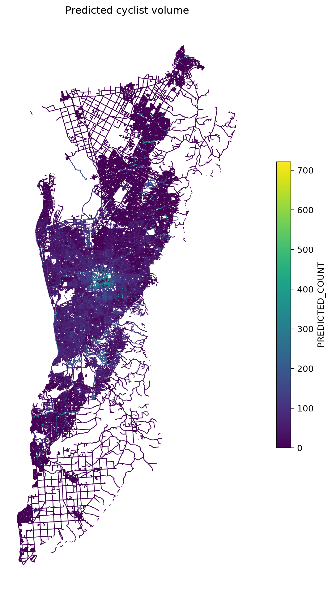

# Modelling Cyclist Volumes In Adelaide, South Australia

*Alexander Huynh, Adelaide University. Supervised by Jamie Mackenzie, Adelaide University.*

## Introduction

This project aims to lay a basic foundation for Cyclist Volume Modelling in Adelaide. For the full report see `REPORT (replace later)`. The product of this project is a predictive model for the Greater Adelaide region, viewable by opening `model_docs/model_data/prediction/model_interactive.qgz` in QGIS. A simplified preview of the model results is shown below.



The model was created using segmented linear regression with ordinary least squares (OLS). `model_docs/model_notebook.ipynb` contains the regression process and `model_docs/model_data/` contains the design matrices and regression results. This work is designed to be continued, and the regression model is also refreshable - the __Model Refresh Tool__ allows for more up-to-date or comprehensive data to be easily used to recalibrate the model's coefficients. To inspect graph generation and the regression process in greater detail, the following python notebooks can be viewed:

- `graph_generation/GRAPH_SETUP.ipynb` - retrieves the Adelaide cycling network, cycling routes, and the census statistical area identifiers - Mesh Block and Destination Zone Codes (from 2021).
- `graph_generation/GRAPH_LOAD.ipynb` - loads infrastructure, spatial, and census data onto edges of the cycling network generated by the previous notebook.
- `model_docs/model_notebook.ipynb` - uses the loaded graph from the previous notebook with supplied cyclist count data (stored in `count_data/`) to generate the final regression model, stored in `model_docs/model_data/prediction/`.

## Using the Model Refresh Tool

The Model Refresh Tool recalibrates the model's coefficients using new cyclist count data, without needing to run the notebooks. You will need:

- A copy of this repository on your computer
- A conda environment with the project's Python packages
- The pre-built graph of the Adelaide cycle network

Steps 1 to 4 only need to be done once. Step 5 onwards is what you repeat each time you have new count data.

### 1. Get the repository

Either:
- **Download a zip:** on the GitHub page, click **Code → Download ZIP**, then unzip it, or
- **Clone with git:** open a terminal and run
  ```
  git clone <https://github.com/ahuyhuy/cyclist-volume-adelaide.git>
  ```

To work in the browser with JupyterLab, open JupyterLab, start a terminal from its launcher, and run the `git clone` command in the folder you want the project to live in. If you don't have git, install it from https://git-scm.com/downloads.

### 2. Create the conda environment

The project's Python packages are listed in two files, `requirements_conda.txt` and `requirements_pip.txt`. From a terminal inside the repository folder, run:

```
conda create --name cyclist-volumes-adelaide python=3.12
conda activate cyclist-volumes-adelaide
pip install -r requirements_pip.txt
```

If you don't have conda, install Miniconda or Anaconda from https://docs.conda.io/en/latest/miniconda.html.

> **Note:** `requirements_conda.txt` records the exact versions the project was built with, but it was exported from a Mac, so some entries point to files on that machine and won't install elsewhere. If a package from it fails, use the three commands above and report the error.

### 3. Download the graph

The Model Refresh Tool does not build the cycle network graph itself, because that takes hours. Download the pre-built graph from this link: https://drive.google.com/drive/folders/1tO3klCw9SWAbWICeORm5qa-w-bNdsnZu?usp=sharing

The download is a folder called `graph_cache`. Place it inside `graph_generation/`, so that the file `graph_generation/graph_cache/graph_loaded.graphml` exists. The tool looks for it at exactly that path.

### 4. Add your count data

Put your cyclist count file in the `count_data/` folder and name it exactly `counts.csv`. It needs these columns:

- `total-count`: the number of cyclists counted at the site
- `x`: the longitude of the count site
- `y`: the latitude of the count site

### 5. Run the tool

In a terminal, from the repository folder, with the `cyclist-volumes-adelaide` environment active:

```
python MODEL_REFRESH_TOOL.py
```

The tool prints each step as it runs. When it finishes it creates a folder named `model_refreshed_YY_MM_DD_HH_MM/` containing:

- `segments/`: the inputs and results for each segment (CBD, CBDP, S, SP)
- `regression_summary.txt`: the combined model results
- `model_YY_MM_DD_HH_MM.gpkg`: the predicted edges, which you can open in QGIS
- `model_preview.png`: a quick-look map of the predictions
- `run_settings.txt`: the settings, inputs and any warnings from this run

If the tool stops with an error, the message says what to fix. If it pauses and asks you to press Enter, read the warning first: it usually means part of the model has too few count points to be reliable.

> **Limitation:** the count data has no time of day or direction of travel, so the model predicts overall volume per road segment, not directional or time-specific flows.

### 6. View counts in detail

The `model_YY_MM_DD_HH_MM.gpkg` output from the model refresh tool can be added as a vector layer in QGIS. See `model_docs/model_data/prediction/model_interactive.qgz` for vector labelling settings.

## Graph Regeneration

The graph generation is handled by `graph_generation/GRAPH_SETUP.ipynb` followed by `graph_generation/GRAPH_LOAD.ipynb`. Running these notebooks requires the same conda environment used by the Model Refresh Tool, plus a further download - `all-data` folder from the same link: https://drive.google.com/drive/folders/1tO3klCw9SWAbWICeORm5qa-w-bNdsnZu?usp=sharing

Place the folder in this main directory. `all-data/` contains a small library of census data, statistical area data, and count data that the graph notebooks rely on. Run the two notebooks in order to load `graph_generation/graph_cache/` with a refreshed cycle network graph.

## Handover Notes

This work is designed to be continued and improved as more data and resources become available. Here are a few notes on what can be improved.

### Updating Census Data

This project was completed in 2026, before that year's Census data became available, so all census data is from 2021. The geographical regions used also correspond to the 2021 census. The model uses data aggregated by *Mesh Block* and data aggregated by *Destination Zone*. Mesh Blocks and Destination Zones are statistical boundaries used by the ABS. They can be downloaded from https://www.abs.gov.au/statistics/standards/australian-statistical-geography-standard-asgs-edition-3/jul2021-jun2026/access-and-downloads/digital-boundary-files

Census data such as `all-data/census-raw/greater-adelaide/A5YG-S-UR-MB.csv` is retrieved via the ABS's Table Builder tool: https://tablebuilder.abs.gov.au

Not every Census data table located in `all-data/census-raw/greater-adelaide` was used in the final model, due to correlations. `graph_generation/GRAPH_LOAD.ipynb` and `graph_generation/join_census_cols.py` could be altered to retrieve different or new census data, to improve the model.


### Regression Improvements

Predicting cyclist volume using regression, as done in this project, is called Direct Demand Modelling. This Direct Demand Model uses Linear Regression with Ordinary Least Squares (OLS), which is the simplest form of regression modelling and most suited to the scarcity of the available count data. Ideally, OLS regression can be replaced with Poisson or Negative Binomial regression. The Suburbs segment (S), which had 74 count points, performed better when Poisson regression was applied, however OLS had to be used to ensure congruency with other segments. As a rule of thumb, if each segment has more than 70 observations, Poisson regression is preferred. This rule of thumb, however, is very dependent on the variance of the count data, and a degree of trial and error should be taken.